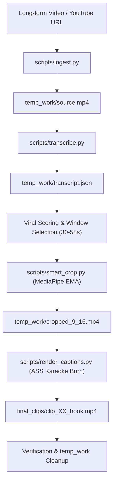

# Universal Clipper: Autonomous Viral Shorts Engine

A production-grade, local vertical video generation engine designed for YouTube VODs, podcasts, interviews, gaming streams, and local long-form footage.

## Architectural Principles

1. **Resolution:** Strictly 1080x1920 (9:16 Portrait Canvas).
2. **Audio-Video Synchronization:** Zero presentation timestamp drift using FFmpeg hardware PTS alignment.
3. **Smooth Subject Framing:** MediaPipe face tracking with Exponential Moving Average (EMA, $\alpha=0.08$) temporal smoothing to eliminate camera pan jitter, automatically transitioning to blurred-background pillarbox during B-roll or gameplay.
4. **Viral Karaoke Captions:** Word-by-word highlighted captions rendered in ASS format (`#FFD700` Gold active word, `Impact` / `Arial Black` font, `\bord6\shad3`, `Alignment=2`, `MarginV=280` safe margin).

---

## Standard Workflow



---

## CLI Execution Guide

All commands must be executed using the isolated virtual environment:

### Step 1: Ingest Video
Download YouTube stream or copy local media into `./temp_work/`:
```bash
./.venv/Scripts/python scripts/ingest.py --input "https://www.youtube.com/watch?v=VIDEO_ID" --output "./temp_work/source.mp4"
```

### Step 2: Extract & Transcribe Audio
Extract audio and produce structured word-level timestamps:
```bash
./.venv/Scripts/python scripts/transcribe.py --input "./temp_work/source.mp4" --output "./temp_work/transcript.json" --model "base"
```

### Step 3: Select Viral Moments
Analyze `./temp_work/transcript.json` to detect 3–5 segments (30–58 seconds each) adhering to:
- **Hook (0–3s):** Immediate curiosity gap, high energy, question, or bold statement.
- **Body (3–45s):** Rapid story progression, conflict, action, or debate.
- **Payoff (Last 5s):** Punchline, realization, climax, or takeaway with complete sentence cuts.

Slice the selected moment:
```bash
./.venv/Scripts/python scripts/ingest.py --input "./temp_work/source.mp4" --start "00:04:15" --end "00:04:55" --output "./temp_work/slice_01.mp4"
```

### Step 4: AI Smart Crop (1080x1920)
Track faces with EMA temporal smoothing or fallback to blurred background:
```bash
./.venv/Scripts/python scripts/smart_crop.py --input "./temp_work/slice_01.mp4" --output "./temp_work/cropped_01.mp4" --smooth-alpha 0.08
```

### Step 5: Transcribe Slice & Burn Karaoke Captions
Generate word-aligned ASS captions and burn them into the final 9:16 deliverable:
```bash
./.venv/Scripts/python scripts/transcribe.py --input "./temp_work/slice_01.mp4" --output "./temp_work/slice_01_words.json"
./.venv/Scripts/python scripts/render_captions.py --video "./temp_work/cropped_01.mp4" --transcript "./temp_work/slice_01_words.json" --output "./final_clips/clip_01_hook-name.mp4"
```

### Step 6: Verify & Cleanup
Confirm `final_clips/` contains valid deliverables (file size > 0, exactly 1080x1920, audio synced), then remove ephemeral files inside `./temp_work/`.
